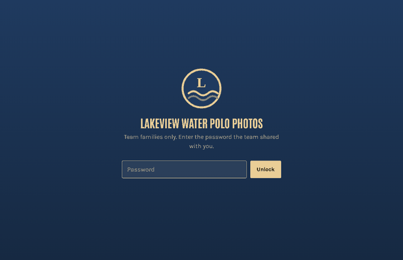

# team-photo-sorter

Sort a team photographer's photos by player and share them with team families
as a private, password-protected website that costs nothing to host.

Volunteer photographers at youth and high school games often shoot thousands of
frames a game. Families then scroll through all of them looking for their own
kid. `team-photo-sorter` finds and groups the faces in every photo **on your own
computer**, then builds a static site where each family picks their player and
gets that player's photos, game by game.



**[Try the demo site](https://andyknosp1.github.io/team-photo-sorter/)** (password `lakeview-demo`).
The demo team's players are illustrations, not real people. It's built by
[examples/demo/make_demo.py](https://github.com/andyknosp1/team-photo-sorter/blob/main/examples/demo/make_demo.py) on every push.

- **Runs locally.** Face detection and grouping happen on your machine. No photo
  or face data is sent to a face-recognition service.
- **No server.** The output is a folder of static files. Host it free on Firebase
  Hosting, Netlify, Cloudflare Pages or GitHub Pages.
- **Private by default.** Everything except the page shell is encrypted
  (AES-256-GCM, key from a shared password). Player names, game names and photos
  are unreadable without the password, and file names reveal nothing.
- **People confirm, the computer suggests.** Families put a name on a face group
  once. The site then offers "Could these also be Sam?" for the same player's
  other groups, and "Same face as Sam in another game" across games. Nothing is
  merged automatically. In team sports, two teammates in matching caps can look as
  similar to the model as one player's sharp and blurry shots do.
- **Scales to a season.** Each thumbnail and viewer image is its own encrypted
  file, fetched only when someone looks at it. Rebuilds are byte-identical for
  anything unchanged, so hosts only re-upload what's new. It grew out of a tool
  used for a full season: about 53,000 photos across 17 games.

> **Read [docs/privacy.md](https://github.com/andyknosp1/team-photo-sorter/blob/main/docs/privacy.md) before using this with photos of minors.**
> This tool creates face embeddings, which many jurisdictions treat as biometric data.
> It is meant for a team photographer sharing with that team's families, with the
> team's knowledge.

## Quick start

Requires Python 3.10+ and 4 GB of RAM. The biggest games, around 20,000
detected faces, need most of that.

```bash
python -m venv .venv && source .venv/bin/activate
pip install team-photo-sorter            # HEIC photos from iPhones: "team-photo-sorter[heic]"

mkdir my-team && cd my-team
tps init                                 # writes team.toml and a .gitignore
```

Put each game's photos in its own folder, then edit `team.toml`: team name,
colours, roster, and one `[[event]]` per game pointing at its folder. The
comments in [the example config](https://github.com/andyknosp1/team-photo-sorter/blob/main/examples/team.toml) explain every setting.

```bash
tps all            # scan faces, group them, make thumbnails, build the site
```

`tps all` asks for the site password the first time. Use a long, random one
(16+ characters), because anyone who gets a copy of the site can try passwords
offline. To skip the prompt, set the `TPS_PASSWORD` environment variable.

The site is in `site/public/`. Deploy that folder to any static host; see
[docs/hosting.md](https://github.com/andyknosp1/team-photo-sorter/blob/main/docs/hosting.md). Share the link and the password with families.

The first run downloads InsightFace's face models (a few hundred MB) into
`~/.insightface`. Check their licence; see [NOTICE](https://github.com/andyknosp1/team-photo-sorter/blob/main/NOTICE).

Tested with InsightFace 1.0.1. InsightFace 2.x reworked its API and isn't
supported yet.

## Working on the code

```bash
git clone https://github.com/andyknosp1/team-photo-sorter.git
cd team-photo-sorter
python -m venv .venv && source .venv/bin/activate
pip install -e ".[dev]" && pytest
```

## Adding a game

Add an `[[event]]` to `team.toml` and run `tps all` again. Everything is
resumable: photos already scanned are skipped, and unchanged files are rebuilt
byte for byte, so a redeploy uploads only the new game.

## Commands

| Command | What it does |
|---|---|
| `tps init` | Write an example `team.toml` and `.gitignore` in the current folder |
| `tps scan [--event ID] [--workers N]` | Detect and embed faces in new photos (resumable) |
| `tps cluster [--event ID]` | Group each game's faces into player tiles |
| `tps images [--event ID]` | Make face crops, contact-sheet thumbnails and viewer copies |
| `tps build` | Build the encrypted site into `site/public/` |
| `tps all` | `scan`, `cluster`, `images`, then `build` |
| `tps labels import FILE` | Add labels that families shared from the site (see below) |
| `tps labels list` | Show the organiser labels in use |
| `tps export --player N --to DIR` | Copy one player's full-resolution photos into a folder per game |

Use `-c path/to/team.toml` to point at a config somewhere else.

## Sharing names across families

Names a family picks are saved only in their browser. To make them visible to
everyone:

1. A family clicks **Share my labels** at the bottom of the site and sends you
   the copied text.
2. You save it to a file and run `tps labels import shared.txt`, then `tps build`.
   Labels are stored by face group, so they survive re-clustering as long as the
   group's best face stays in it.

You can also pre-name a player in every game from a few reference photos of
their face. Add a `[[seed]]` to the config and see
[docs/how-it-works.md](https://github.com/andyknosp1/team-photo-sorter/blob/main/docs/how-it-works.md#reference-photos).

## Linking to photos hosted elsewhere

By default the site includes a viewer-size copy of each photo (1280 px on the
long side, about 200 KB). If the originals are already in a shared album
somewhere, give the event a `links` CSV with columns
`filename,view_url,download_url`. The site then links each photo there, and
you can set `full_size = 0` to keep the site small. See
[examples/links.csv](https://github.com/andyknosp1/team-photo-sorter/blob/main/examples/links.csv).

## Documentation

- [How it works](https://github.com/andyknosp1/team-photo-sorter/blob/main/docs/how-it-works.md): the pipeline and the decisions behind it
- [Hosting](https://github.com/andyknosp1/team-photo-sorter/blob/main/docs/hosting.md): Firebase, Netlify, Cloudflare Pages and GitHub Pages, plus free-tier sizing
- [Security](https://github.com/andyknosp1/team-photo-sorter/blob/main/docs/security.md): what the password protects and what it doesn't
- [Privacy](https://github.com/andyknosp1/team-photo-sorter/blob/main/docs/privacy.md): photos of minors, consent and biometric data
- [Configuration reference](https://github.com/andyknosp1/team-photo-sorter/blob/main/docs/configuration.md)

## Limitations

- One shared password for everyone. It's not user accounts, and it can't be
  revoked per family; change the password and rebuild to cut off access.
- Grouping works on faces only, so backs of heads and fully covered faces are
  missed. Expect each player to be split across a few groups per game, and expect
  some groups that aren't on the team (opponents, referees, parents); families can
  hide those.
- CPU only. Scanning runs at roughly 0.2–0.5 s per photo per core.
- Very large single events (over ~20,000 faces) need splitting, for example one
  event per tournament day.

## License

[Apache License 2.0](https://github.com/andyknosp1/team-photo-sorter/blob/main/LICENSE). Copyright 2026 Andy Knosp. The face models are not
part of this project and have their own licence; see [NOTICE](https://github.com/andyknosp1/team-photo-sorter/blob/main/NOTICE).
